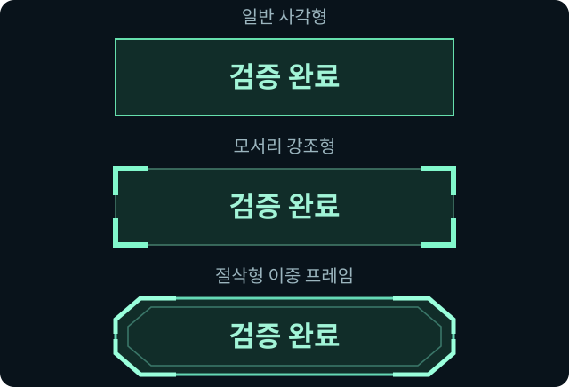

# 작업 계열별 완료 연출과 완료 박스 테두리 (2026-11-26)

## 사용자 확인 사항
- 유사한 작업은 동일 도구와 완료 연출을 공유한다. 서로 다른 작업은 목적에 맞는 고유 연출을 유지한다. 모든 퍼즐에 동일 박스를 강제하지 않는다.
- 게임 전체 디자인 언어(팔레트, 선 굵기, 발광 질감)는 일관되게 유지하되 완료 연출은 작업 계열별로 통일한다.
- v0.51의 이상 탐지·일치 검증 성공 이펙트에 대해 사용자가 긍정 평가. 이펙트 강도와 시간은 유지하고 완료 박스의 테두리만 다듬는 방향.
- 인증 코드 탐색의 기존 자물쇠 해제 연출은 유지. 박스형 완료 효과로 대체하지 않는다.

## 완료 박스 비교 시안

채팅에서 제시한 벡터 도식을 동일한 도형 좌표·색·선 굵기·문구로 SVG에 재현했다. 첫째 일반 사각형, 둘째 모서리 강조형, 셋째 절삭형 이중 프레임. 셋째를 박스형 완료 효과의 우선 적용 시안으로 제안했으며, 실제 적용 후 검수 및 디자인 확정이 필요하다.
- 모서리 사선 절삭, 얇은 내부선과 밝은 외부선, 모서리 강조.
- 프레임 형성 시 모서리에서 빛이 뻗어 완성되고 짧게 발광 후 안정되는 방식은 구현 후보. 기존 성공 절정과 타이밍에 맞춰야 한다.
- v0.51의 1.8초 결과 확인 → 1.6초 스캔 → 1.5초 완료 표시, 정답 점등/빛 확산/효과음/복귀 후 권한 점등 보존. 기존 승인 연출 변경 금지.

## 작업 계열별 적용 범위
| 계열 | 연출 | 상태 |
|---|---|---|
| 탐지·검증 | 스캔, 테두리 동기화, 동시 점등, 완료 박스 | ID01/02 v0.51 구현, 박스 테두리 수정 대기 |
| 인증 | 자물쇠 해제 | ID11 기존 구현 유지 |
| 복구 | 손상된 데이터 복원 | 후보 |
| 연결 | 연결 경로를 따라 신호 전달 | 후보 |
| 차단 | 연결선 단절, 대상 고립 | 후보 |
| 회로 | 전류 흐름, 장치 활성화 | 후보 |

후보 계열은 향후 실제 생성·판정·작업 목적을 검토하고 승인 후 적용한다. 격리·삭제 등 작업 목표 외의 기능을 추가하지 않는다.
이번 작업은 참고 이미지 및 확정 원칙 문서화만 수행한다. 최신 실행본 v0.51 미변경, 신규 실행 검수 없음. 다음 작업은 ID01/02의 완료 박스 테두리 개선 및 검수, 이후 기존 로드맵의 ID03 오류 검출.

## v0.52 적용 및 검수
우선 시안인 절삭형 이중 프레임을 ID01/02의 성공 카드에 구현. SVG 외곽/내부선 및 네 모서리 강조선, .29초 애니메이션과 .04초 지연(감소 모션 즉시 표시). 이전 사각형과 두 모서리 의사 요소를 대체. 기존 4.9초 및 점등·파동·효과음·권한 복귀 보존. v0.51과 소스 비교: 두 스캐너의 프레임 CSS/SVG와 버전 표기 외 동일, 인증 포함 다른 코드 불변. Chromium 가로 4종×3난도×2퍼즐 24/24, 도움말 8회, 각 5단계 설명 총 40상태, 권한 복귀·스캔 동기화·JS 오류 없음. 640×300 및 844×390 어려움 렌더링 확인, 640×300 완료 정착 상태는 CSS 애니메이션 종료 캡처로 확인. 가상 시계와 임무 상태 주입 사용. 실제 스마트폰/청취 및 전체 회귀는 별도. 실행본 v0.52 blob c2ea0c664c9b595a95c5c3f543bde3f57f40c618, 원본 일치, 커밋 5dfe5881. 디자인 최종 사용자 확인 대기, 다음 ID03.
